

<table>
<tr>
<td width="38%" valign="middle" align="center">
</td>
<td width="62%" valign="middle" align="center">
</td>
</tr>
</table>

  

 

## About

I'm a final-year B.Tech CSE (AI & ML) student in Bangalore, graduating in 2027. I build AI systems that do real work: LLM analytics pipelines, browser agents with human approval gates, and multimodal diagnostic models. Based in Bangalore, India, and open to relocation.

- **Edunext Technologies**, Software Engineer Intern, Apr to May 2026. Built an AI finance analytics platform as a LangGraph state-machine pipeline with rule-based and LLM-fallback routing, connected to Power BI dashboards. It runs on 10+ FastAPI endpoints over 50,000+ student fee records and cut manual reporting effort by 80% across 20+ client organizations.
- **IEEE Bangalore Section**, AI Intern, Apr to Jul 2025. Built OncoVision, a dual-output EfficientNetB0 that classifies eight cancer types and detects malignancy from histopathological images, at 97.99% and 98.13% accuracy.
- **Right now**, building MedReasonAI (an agentic multimodal diagnostic assistant) and sharpening RAG pipeline design.

 

## My journey so far


 

## Featured work

<table width="100%">
<tr>
<td width="50%" valign="top">

### [OneForAll Agent](https://github.com/adieladaniel/OneForAll-Agent)
*Autonomous browser agent for multi-step business tasks*

- A runtime-enforced human approval gate and an independent verifier check every run
- Multi-user platform with roles, a PostgreSQL job queue with crash recovery, and a credential vault
- Load test: 280/280 runs passed ground truth, 0 cross-org leaks across 47,508 responses

 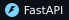 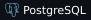 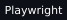 

</td>
<td width="50%" valign="top">

### [MedReasonAI](https://github.com/adieladaniel/medreason-ai)
*Agentic multimodal diagnostic assistant*

- Fuses chest X-ray, lab values and radiology text
- Linked 53,000+ chest X-ray studies to clinical and lab records, and queried an 18GB+ lab-events dataset with DuckDB
- Fusing unimodal models (MIMIC-CXR DenseNet, ClinicalBERT) lifted macro F1 from 0.51 to 0.61, with SHAP and Grad-CAM explanations

   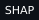

</td>
</tr>
<tr>
<td width="50%" valign="top">

### [FinnBot](https://github.com/adieladaniel/FinnBot-Financial-AI-Analytics-Engine)
*Hybrid analytics chatbot over your own data*

- Answers natural-language questions over uploaded or API-fetched data
- Rule-based query planning with a Gemini fallback for low-confidence questions
- Generates charts automatically

  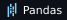 

</td>
<td width="50%" valign="top">

### [Obsidian RAG Assistant](https://github.com/adieladaniel/obsidian-rag-assistant)
*Local agentic RAG over an Obsidian vault*

- Answers questions about your notes with citations back to the source
- An agentic retrieval loop reformulates the query up to 3 times when the context is thin

  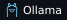 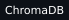 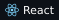

</td>
</tr>
<tr>
<td width="50%" valign="top">

### [OncoVision](https://github.com/adieladaniel/OncoVision)
*Cancer classification and malignancy detection*

- Dual-output EfficientNetB0 on histopathological images: eight cancer types plus malignancy detection
- 97.99% classification accuracy and 98.13% malignancy detection
- Built as an AI Intern at IEEE Bangalore Section

  

</td>
<td width="50%" valign="top">

### [PromptSense AI](https://github.com/adieladaniel/PromptSense-AI)
*Prompt quality analyzer and optimizer*

- Hybrid rule-based and transformer scoring of LLM prompts, with automatic rewrites of weak ones
- Written up as a team research paper

  

</td>
</tr>
<tr>
<td width="50%" valign="top">

### [Prognix](https://github.com/adieladaniel/Prognix)
*Decision support for hospital biomedical teams*

- Predicts medical equipment failure so teams can plan ahead

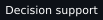 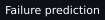

</td>
<td width="50%" valign="top">

### [Web Security Checker](https://github.com/adieladaniel/Web-Security-Checker)
*Web reconnaissance and OSINT platform*

- Full-stack platform for website security analysis

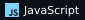

</td>
</tr>
</table>

All repositories are on <a href="https://github.com/adieladaniel?tab=repositories">my profile</a>.

 

## Right now


 

## Toolbox

<table>
<tr>
<td><b>Languages</b></td>
<td>
 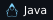     
</td>
</tr>
<tr>
<td><b>Web and backend</b></td>
<td>
 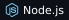  
</td>
</tr>
<tr>
<td><b>ML and data</b></td>
<td>
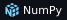  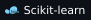   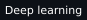 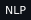
</td>
</tr>
<tr>
<td><b>GenAI and agents</b></td>
<td>
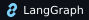 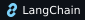 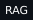  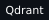 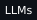 
</td>
</tr>
<tr>
<td><b>Tools</b></td>
<td>
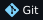  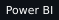 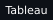 
</td>
</tr>
</table>

 

<b>Certifications</b> (7)

 

- Claude Code in Action, Anthropic
- AI Skills Passport, EY and Microsoft
- AWS Academy Cloud Foundations
- Prompt Engineering, Infosys Springboard
- Generative AI: From Prompts to Partnership, LinkedIn Learning
- Networking Essentials, Cisco Networking Academy
- Fundamentals of Operating System, Scaler

 

Thanks for stopping by. Always up for a conversation about agentic AI, GenAI or a good LeetCode problem.

 

Reach me at <a href="mailto:adieladaniel2006@gmail.com">adieladaniel2006@gmail.com</a>

